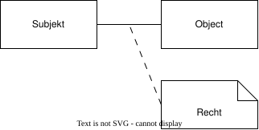
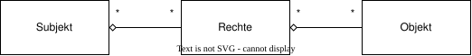
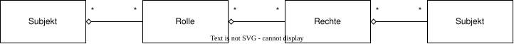
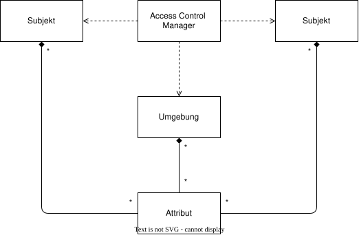

# Access Controle

```Access Control``` kurz ```AC```, beschreibt allgemein das eine Beziehung zwischen Subjekt (User) und Objekt (Ressource) hergestellt wird. Daher kann diese Beziehung auf oberster Ebene (ohne Normalisierung) auch als Assiziation zw. Subjekt und Object dargestellt werden. Dies Beziehung beschreibt im übertragenen Sinn, wie ein ```Recht``` zustande kommt. Die Assiziation stellt in diesem Fall das Recht dar, welches nicht näher spezifiziert ist. Durch Normalisierung, können weitere Muster entstehen.



Im philisophischen Sinn (oft auch Juristisch genutzt) gilt für ein ```Recht``` oder ```Gesetz``` ein Zitat von Aristoteles:

> "Gesetz ist Vernunft, frei von Leidenschaft"

## Basics im Umgang mit Berechtigungen

Keinem Nutzer sollten über mehr Recht Verfügen als für seine Tätigkeit tatsächlich benötigt werden. Dies bedeutet nicht, dass dieser für verschiedene Tätigkeiten verschiedene Accounts benötigt. Lediglich bei (fast) uneingeschränkten Benutzern (z.B. Administratoren) sollte über eine solche Trennung nachgedacht werden.

Administratoren sind technische Nutzer und sollten an der täglichen Geschäftsätigkeit am System im regulären Betrieb nicht beteiligt werden. Lediglich zur Behebung von technischen Problem oder für grundlegende Änderungen am Systems, sind Administratoren notwendig.

__TIP:__ Vermeiden Sie es in der Rolle eines Administrators am Tagesgeschäft teil.

__TIP:__ Nehmen Sie sich das Zitat von Aristoteles zu Herzen. Lassen Sie sich nicht auf emotionale Bedürfnisse nach mehr Kontrolle einzelner Objekte (User) ein und betrachten Sie nach Vernunft und frei von Leidenschaft.

## Authentifizieren und Autorisieren

```Autorisieren``` beschreibt wie es zum Gewähren der Berechtigung kommt. ```Authentifizieren``` wie festgestellt wird, ob das Subjekt auch das Subjekt ist das es bauptet zu sein. 

In der realen Welt wird zum ```Authentifizieren``` häufig Personalausweis oder eine Unterschrift verlangt. In der digitalen  Welt typischerweise werden Credetionals wied Benutzername und Passwort oder besser noch weitere Varianten wie 2 Faktor Authentifizierung verwendet.

Die meisten ```AC``` setzen auf Verfahren beim ```Autorisieren```, welches eine ```Authentifizierung``` voraussetzt. Diese ist jedoch abhängig vom Verfahren und nicht abhängig von einer ```Autorisierung```.

## Übliche Ausprägungen

### Discretionary Access Control

Kurz ```DAC```, beschreibt die Zuweisung von Rechten direkt am Objekt. Rechte werden hier als Klasse eingeführt. Ein Subjekt kann mehrere Rechte haben, ein Recht kann mehrere Subjekte haben.



### Role-Based Access Control

Kurz ```RBAC``` beschreibt in einer einfachen Normalisierung, die Beziehungen wir ```DAC```. Jedoch wird zw. Subjekt und Recht die Klasse Rolle eingeführt. Ein Subjekt kann mehrere Rollen haben, eine Rolle kann mehrere Recht haben und ein Recht kann mehrere Subjekte haben.



#### Klassische Rollen

Fast in jedem System und insbesondere in Content Management System gibt es mehrere typische Rollen. Diese werden hier beschrieben.

##### Consumer (public und private)

Der Consumer ist der letztendlich Nutzer der Daten. Er nimmt dies normalerweise ausschließlich lesender wahr. Er existiert in manchen Sysemen in zwei Varianten: Public und Private. 

Der Public Consumer ist ein nicht authentifizierter Benutzer. Sprich er hat ausschließlich auf Daten Zugriff, welche uneingeschränkt öffentlich zugänglich sind.

Der Private Consumer ist ein authentifizierter Benutzer. Sollen z.B. Inhalte hinter ein Paywall lesbar sein, wird hier sichergestellt, dass der Benutzer entsprechende Rechte besitzt.

##### Autor

Der Autor erstellt Inhalte. Er übernimmt in erster Instanz jedoch keine Verantwortung für seine Inhalte.

##### Redakteur

Der Redakteur übernimmt die Verantwortung für die Veröffentlichten Inhalte. Er hat sicherzustellen das diese korrekt und rechtsmäßig sind. Im idealfall ist er ausschließlich für die Freigabe von Inhalten zuständig, welche durch Autoren verfasst wurden. Heufigt (gerade bei System mit wenig Benutzern) wird die Rolle des Autors und des Redakteurs kombiniert.

### Attribute-Based Access Control

Kurz ```ABAC``` beschreibt, dass das Access Control System  verschiedene Attribute Betrachtet um zu einer Entscheidung zu kommen. Dabei können die Attribute des Subjekt, des Objekts sowie Attribute der Umgebung betrachtet werden.



Häufig werden ```ABAC``` Systeme dazu verwendet eine ```RBAC``` System nachzubilden. Dabei werden die Rollen als Attribut einfach übergeben. Dies unterstreicht die Flexibilität, die sich beim Einsatz ergeben.

```ABAC``` Systeme setzen nicht zwingend auf ```Authentifizierung``` ihrer Subjekte. Wenn es sich z.B. um Altersfreigaben handelt, kann dieses als Attribut betrachtet werden, ohne das Subjekt zu ```Authentifizieren```. Oft lässt sich dieses aber auch nicht trennen.

### Mandatory Access Control

Mandatory Access Control Systeme ähneln in vielerlei Hinsicht ```ABAC```. Sie können alle ihnen zur Verfügung stehenden Informationen auswerten und geben Regelbasiert die Berechtigung oder nicht. Der unterschied liegt darin, das ```ABAC``` Systeme ausschließlich über starre Regeln verfügt und sich lediglich die Attribute ändern. Mandatory Access Control Systeme hingegen sind eher mit einem individuellen Programmcode zu vergleichen, des bei passenden eingaben eine ```Autorisierung``` erteilt.

__Quasi wie Voodoo einer Magie:__ Der Zauberspruch muss an einem Dienstag bei Vollmond, um Mitternacht, von 2 Blonden und 3 Brünetten Zauberern/Zauberinnen, ohne eine schiefe Note gesunden werden.

Ein klassisches Beispiel ist die ```Chinese Wall```. Ein verfahren bei dem verhindert werden soll, das es zu strafbaren Interessenkonflikten oder Insiderhandel in der Finanzwelt kommt. Dabei werden alle zur Verfügung stehenden Informationen individuell betrachtet und ausgewertet um einen Konflik auszuschließen.